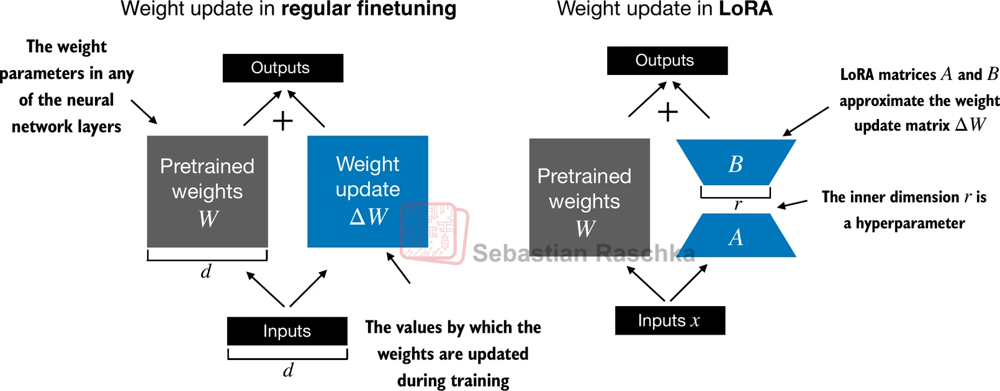

# LoRA
> 关于论文 `LORA: LOW-RANK ADAPTATION OF LARGE LANGUAGE MODELS` 前四部分：`1 INTRODUCTION` 、 `2 PROBLEM STATEMENT` 、 `3 AREN’T EXISTING SOLUTIONS GOOD ENOUGH?` 、 `4 OUR METHOD` 的总结
## ABSTRACT
1. 如何理解 `deploying independent instances of fine-tuned models, each with 175B parameters`: “为每个任务单独部署一套微调后的完整模型，每个模型有 175B 个参数”  
**解析：**
全参数微调结束后得到一份独立、完整的模型权重文件，一个任务对应一套完整权重，多任务就要保存、加载多份多份**同结构完整模型权重**。
    - 全微调流程：原始基座 $W_{base}$，任务 A 微调得到 $W_A$，任务 B 微调得到 $W_B$；$W_A、W_B$ 都是完整 175B 参数，互相独立。
    - 部署含义：上线多个任务服务，就要把多份完整大模型分别加载进显存，硬盘存储也是多份完整权重文件。
    - 和 LoRA 对比：LoRA 只保存一份基座，不同任务只保存体积很小的 LoRA 增量矩阵，不需要维护多套完整底座。
    - 核心痛点：任务越多，存储、显存、服务器成本线性暴涨，所以原文说成本高到难以承受。

    > [!NOTE]  
    > 全微调修改的是模型本体权重，任务能力固化在整套权重中，无法简单切换任务。  
    > 全微调：一任务一整套大权重；LoRA：共用基座，任务能力存放在低秩小矩阵。

2. 如何理解 `unlike adapters,no additional inference latency.`: LoRA 和 adapters（适配器）不一样，它无额外推理延迟
**解析：**
核心区别：Adapter 推理主路径上永久新增计算支路（含非线性）；LoRA 为纯线性增量，支持离线权重合并。
    - Adapter 前向公式：$X' = X + \text{Up}(\sigma(\text{Down}(X)))$, 包含 $\sigma$（GELU/ReLU 非线性激活）。非线性无法化简融合进原生线性矩阵 $Y = XW$。**每生成一个 token，都必须重复跑 Down - 激活 - Up 整套算子，额外计算嵌入在线推理循环里，必然增加延迟。**
    - LoRA 分训练、推理两个阶段：
        1. 训练阶段：$Y = XW + XBA$，此时确实两路计算；
        2. 推理合并（关键）：全部是线性运算，可合并为 $W_{merged}=W+BA$，推理公式简化为 $Y=XW_{merged}$，变回原生单次矩阵乘法，计算链路没有新增算子。
    
    > [!NOTE]  
    > 补充工程两种 LoRA 部署模式：
    > - 模式 A（论文实现）：提前合并权重，零推理额外开销；
    > - 模式 B（动态切换 LoRA 场景）：不合并，推理时两路并行计算，此时 LoRA 同样会增加推理延迟，属于工程取舍，不是 LoRA 理论固有特性。

## 1 INTRODUCTION
`full fine-tuning（全参数微调）`的主要缺点是，新模型包含与原始模型相同数量的参数。因此有了下面几个方向的办法：  
- adapting only some parameters
- learning external modules: `Adapter`
- extending model depth：`Adapter`
- reduce the model’s usable sequence length: `Prompt Tuning / Prefix Tuning`  

但以上办法仍有待改进：`posing a trade-off between efficiency and model quality`  
后面提出了 LoRA 方法, 打破了这个 `trade-off`

**LoRA 和许多先前的轻量化方法是正交（orthogonal）的，能够和其中不少方法（例如前缀微调 prefix-tuning + LoRA）组合使用**  
## 2 PROBLEM STATEMENT
### 公式 (1)：全参数微调的优化目标
$$\max_{\Phi} \sum_{(x,y)\in \mathcal{Z}} \sum_{t=1}^{|y|} \log\big(P_{\Phi}(y_t \mid x,y_{<t})\big) \tag{1}$$

符号说明：
- $\mathcal Z$：下游任务数据集，样本是 $(x,y)$ 输入-输出对
- $y_t$：输出序列 $y$ 的第 $t$ 个token
- $y_{<t}$：$t$ 时刻之前已经生成出来的所有token（$y_1,y_2,...,y_{t-1}$）
- $P_{\Phi}(y_t \mid x,y_{<t})$：给定输入 $x$ 和前文 $y_{<t}$，模型预测下一个token为 $y_t$ 的概率
- $\log$：对数，最大化对数似然等价于最小化交叉熵损失，是自回归生成标准目标
- $\max_{\Phi}$：**$\Phi$ 是全部模型参数，全部都参与更新**（这就是全参数微调）

物理含义：遍历数据集中所有样本，对每个输出序列里每一个位置的token，累加对数概率，让总和尽可能大。

> 对应前文：全参数微调时，初始权重 $\Phi_0$ → 更新之后权重 $\Phi=\Phi_0+\Delta\Phi$；$\Delta\Phi$ 和基座本身一样大。  
> 👉 痛点：GPT-3 175B场景，一个任务就要存一整套完整175B参数。

### 公式 (2)：LoRA 这类参数高效微调的通用形式
$$\max_{\Theta} \sum_{(x,y)\in \mathcal{Z}} \sum_{t=1}^{|y|} \log\big(p_{\Phi_0+\Delta\Phi(\Theta)}(y_t \mid x,y_{<t})\big) \tag{2}$$

核心变化：
1. $\boldsymbol{\Phi_0}$ **固定冻结，不再被优化**！不再去更新基座参数
2. 不再直接优化巨大的 $\Delta\Phi$；而是引入一套**很小的参数 $\boldsymbol{\Theta}$**
3. $\Delta\Phi(\Theta)$：巨大的权重增量 $\Delta\Phi$，是由小参数 $\Theta$ 计算、编码得到的函数
    在LoRA里：$\Theta$ 就是所有的A、B低秩矩阵；$\Delta W=BA$，也就是 $\Delta\Phi(\Theta)$ 的具体实现
4. 现在优化对象变成 $\boldsymbol{\max_{\Theta}}$，只更新很小的 $\Theta$

> $|\Theta| \ll |\Phi_0|$：小参数集的参数量远远小于基座参数量  
> 论文后面给出数据：GPT-3 175B场景，$\Theta$（LoRA的A/B矩阵）参数量仅为基座的 **0.01%**

## 3 AREN’T EXISTING SOLUTIONS GOOD ENOUGH?
- **Adapter Layers Introduce Inference Latency(Adapter)** 
- **Directly Optimizing the Prompt is Hard（Prefix Tuning）**

## 4 OUR METHOD
### Source
`When adapting to a specific task, Aghajanyan et al.(2020) shows that the pre-trained language models have a low “instrisic dimension” and can still learn efficiently despite a random projection to a smaller subspace. Inspired by this, we hypothesize the updates to the weights also have a low “intrinsic rank” during adaptation. `  
在适配特定下游任务时，Aghajanyan 等人（2020）的研究表明：预训练语言模型具备很低的**内在维度（intrinsic dimension）**，即便把参数随机投影到一个更小的子空间内，依然可以高效学习。受这个结论启发，作者提出假设：**模型适配任务过程中，权重的增量更新量 $\Delta W$ 本身也具备很低的内在秩**。
### 初始化策略
`We use a random Gaussian initialization for A and zero for B, so \(\Delta W = BA\) is zero at the beginning of training`  
矩阵A采用高斯随机初始化，矩阵B初始化为全 0；因此训练刚开始时 $\Delta W=BA=0$，也就是一开始权重增量为 0，不会打乱原始基座模型。训练起点 $\Delta W=0$，模型一开始完全等价原始基座，微调是慢慢叠加改动，稳定性更好。
### 缩放机制
`When optimizing with Adam, tuning α is roughly the same as tuning the learning rate if we scale the initialization appropriately. As a result, we simply set α to the first r we try and do not tune it. This scaling helps to reduce the need to retune hyperparameters when we vary  r (Yang & Hu, 2021).`  
使用 Adam 优化时，如果初始化设置得当，调节 $\boldsymbol{\alpha}$ 大致等价于调节学习率。因此，我们只需要把 $\boldsymbol{\alpha}$ 固定为第一次尝试的r所配套的值，不再额外调优 $\alpha$。这套缩放机制，让我们更换秩r的时候，不必重新调试超参数。
$$h = W_0 x + \frac{\alpha}{r}\cdot BAx \tag{3}$$

1. `tuning α is roughly the same as tuning the learning rate`: 
    - 学习率的作用：控制**参数每次更新的步幅大小**。学习率越大，每一轮参数 A、B 改动越多，对模型的修改越激进。
    - $\alpha$ 的作用：控制**LoRA 这条分支信号（$BAx$）本身的强弱**：当 r 一定时，$\alpha$ 变大 → $\frac{\alpha}{r}\cdot BAx$ 整体变大 → 传给损失的修正信号变强 → 算出来的梯度效果变强，等效于更新力度变大; $\alpha$ 变小 → 修正信号变弱 → 梯度带来的改动更温和。

    所以在这套特定初始化（A 高斯、B 零初始化）+Adam 的组合下：**改信号强度（$\alpha$），带来的训练效果变化，和直接改学习率很像。**

2. `we simply set α to the first r we try and do not tune it`: 
    - 常规做法：选定一个 r（比如 r=2），去搜索合适的 $\alpha$ 或者合适的学习率，找到一组效果最好的搭配。
    - 论文做法：**只在第一次实验（比如第一次试 r=8）调好一个 $\alpha$，之后不再改动 $\alpha$。** 后面你想试 r=2、r=4、r=16…… 全部继续用这个 $\alpha$ 不变，只换 r。

3. `This scaling helps to reduce the need to retune hyperparameters when we vary  r`:   
    不加缩放时，$\|BAx\| \propto \sqrt{r}$，r 越大，$BAx$ 本身天然越大（天然信号增长）
    - ❌ 无缩放方案（现在很多 PEFT 默认做法）: r 改变 → $BAx$ 平均信号强度跟着变 → 最优学习率跟着变 → **每换一个 r，就要重新搜索学习率**，调参工作量大
    - ✅ 论文缩放方案: $\text{缩放后增量} = \frac{\alpha}{r} \cdot BAx= \alpha \cdot \left(\frac{1}{r} \cdot BAx \right)$。 当进行第一次实验后$\alpha$ 固定, r 变大的同时，除以 r，把 r 变大天然带来的 LoRA 分支信号增长抵消掉。**不同 r 对应的有效训练强度大致维持在同一水平**。不需要每次换 r 都重新调学习率、调 $\alpha$ → 超参搜索成本下降。
    > $\boldsymbol{1/r}$：只做 r 之间的相对补偿  
    > $\boldsymbol{\alpha}$：提供一个独立的全局强度旋钮，用来统一控制 LoRA 分支的影响力