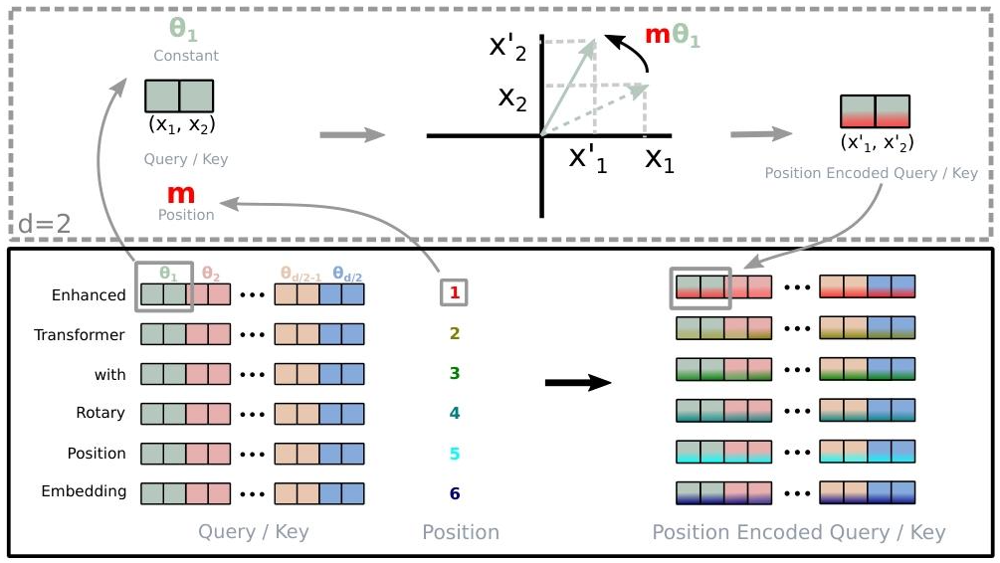

**预备知识**  
**Scaled Dot-Product Attention**：

$$
a_{m,n} = \frac{\exp\left(\dfrac{\pmb{q}_m^\top \pmb{k}_n}{\sqrt{d}}\right)}{\sum_{j=1}^{N} \exp\left(\dfrac{\pmb{q}_m^\top \pmb{k}_j}{\sqrt{d}}\right)}
$$

$$
\pmb{o}_m = \sum_{n=1}^{N} a_{m,n} \pmb{v}_n
$$

# RoPE 旋转位置编码
关于论文 `ROFORMER: ENHANCED TRANSFORMER WITH ROTARY POSITION EMBEDDING`第三部分 `3 Proposed approach` 的总结
> RoPE 的特点：编码绝对位置、天然表达相对位置、支持序列长度外推、兼容线性注意力

## Formulation 
**Goal: 找到一种等效的编码机制，求解出函数 $f_q(x_m, m)$ 和 $f_k(x_n, n)$ ，使它们满足下述关系(理想约束条件)**

$$
\langle f_q(x_m, m), \; f_k(x_n, n) \rangle = g(x_m, x_n, m - n) \tag{1}
$$

> 【经过位置编码后的 query 向量】和【经过位置编码后的 key 向量】做内积，得到的结果，应当只由词嵌入向量 $x_m,x_n$ 、以及相对位置 $m-n$ 这三者决定。

## Rotary position embedding

### 二维情形
`公式（1）` 的一组解为：

$$
\begin{aligned}
f_q(x_m, m) &= (W_q x_m) e^{im\theta} \\
f_k(x_n, n) &= (W_k x_n) e^{in\theta} \\
g(x_m, x_n, m-n) &= \text{Re}\left[(W_q x_m)(W_k x_n)^* e^{i(m-n)\theta}\right]
\end{aligned} \tag{2}
$$

> 1. 公式（2）中的符号说明：
> - $x_m$ : 第 m 个 token 的原始词嵌入；m 是它的位置
> - $x_n$ : 第 n 个 token 的原始词嵌入；n 是它的位置
> - $W_q,W_k$ : Transformer 里 Query、Key 的线性投影矩阵
> - $f_q(x_m,m)$ : **带位置信息的 Query 向量**（我们要构造的变换函数）
> - $f_k(x_n,n)$ : **带位置信息的 Key 向量**
> - $e^{im\theta }$ = $\cos m\theta + i\sin m\theta$ ：复数旋转因子，作用是把经过$W_q$线性投影后的词嵌入向量**按自己的绝对位置 $m$ 旋转 $m\theta$ 角**
>  - $e^{in\theta }$ = $\cos n\theta + i\sin n\theta$ ：复数旋转因子，作用是把经过$W_k$线性投影后的词嵌入向量**按自己的绝对位置 $n$ 旋转 $n\theta$ 角**
> - $(\cdot)^*$ ：复数共轭
> - $\mathrm{Re}[\dots]$ ：取复数结果的**实部**（我们最后要得到一个实数注意力分数）
> ---
> 2. 复数空间里面两个向量做内积，数学定义就要求：**第二个向量取共轭再相乘**。
>
> $$\Big[(W_k x_n)\, e^{in\theta}\Big]^* =\pmb{\big(W_k x_n\big)^*}\cdot \pmb{\big(e^{in\theta}\big)^*}$$
>
> $$\big(e^{in\theta}\big)^*=\cos n\theta - i\sin n\theta = e^{-in\theta}$$
>
> ---
> 3.  $\langle f_q(x_m, m), \; f_k(x_n, n) \rangle$ 的关键效果
>
> $$e^{im\theta}\cdot \big(e^{in\theta}\big)^* =e^{im\theta} \cdot e^{-in\theta} =\pmb{e^{i(m-n)\theta}}$$
>
> 原本两个绝对位置 $m$ 、$n$ ，相减变成**相对位置 $m-n$**

其中 $\mathrm{Re}[\dots]$ 是复数的实部，$\pmb{\big(W_k x_n\big)^*}$ 表示 $\pmb{\big(W_k x_n\big)}$ 的共轭复数。$\theta \in \mathbb{R}$ 是预设的非零常数。我们可以进一步将 `公式（2）` 中 $f_{\lbrace q,k\rbrace}$ 的复数指数形式改写成三角函数旋转矩阵形式：

$$
f_{\lbrace q,k\rbrace}(x_m,m) =
\begin{pmatrix}
\cos m\theta & -\sin m\theta \\
\sin m\theta & \cos m\theta
\end{pmatrix}
\begin{pmatrix}
W_{\lbrace q,k\rbrace}^{(11)} & W_{\lbrace q,k\rbrace}^{(12)} \\
W_{\lbrace q,k\rbrace}^{(21)} & W_{\lbrace q,k\rbrace}^{(22)}
\end{pmatrix}
\begin{pmatrix}
x_m^{(1)} \\
x_m^{(2)}
\end{pmatrix} \tag{3}
$$

### 一般形式（2D --> 高维）
**工程实现**  
  

**论文实现**   

$$
f_{\lbrace q,k\rbrace}(\pmb{x}_m, m) = \pmb{R}_{\Theta,m}^d \pmb{W}_{\lbrace q,k\rbrace} \pmb{x}_m \tag{4}
$$

$$
R_{\Theta,m}^d =
\begin{pmatrix}
\cos m\theta_1 & -\sin m\theta_1 & 0 & 0 & \dots & 0 & 0 \\
\sin m\theta_1 & \cos m\theta_1 & 0 & 0 & \dots & 0 & 0 \\
0 & 0 & \cos m\theta_2 & -\sin m\theta_2 & \dots & 0 & 0 \\
0 & 0 & \sin m\theta_2 & \cos m\theta_2 & \dots & 0 & 0 \\
\vdots & \vdots & \vdots & \vdots & \ddots & \vdots & \vdots \\
0 & 0 & 0 & 0 & \dots & \cos m\theta_{d/2} & -\sin m\theta_{d/2} \\
0 & 0 & 0 & 0 & \dots & \sin m\theta_{d/2} & \cos m\theta_{d/2}
\end{pmatrix}
$$

$$
\Theta=\lbrace \theta_i = 10000^{-2(i-1)/d},\ i\in[1,2,...,d/2]\rbrace
$$

> **NOTE**
> 1. d 维空间会拆分为 $d/2$ 个二维子空间，所以 d 是偶数
> 2. 为什么可以将 d 维空间拆分为 $d/2$ 个二维子空间：
>    - 特殊高维正交旋转可以拆解成多个独立二维平面正交旋转。高维空间完整的旋转矩阵（特殊正交矩阵 $SO(d)$ ），在线性代数里有一个结论：一个特殊高维旋转（纯旋转，其正交矩阵对应的行列式值为`+1`），可以分解成最多 $\lfloor d/2 \rfloor$ 个二维平面正交旋转（块对角正交旋转矩阵形式），各个平面互不干扰。
> 3. 内积的线性可加性：两个高维向量的总内积 = 每一组二维子向量内积相加。只要每一组二维子向量内积都满足「内积只和相对距离有关」，全部加起来之后，整体 $q_m^T k_n$ 内积依然只和相对距离有关。这就是拆分方案合法的核心保障。
> 4. `公式（4）` 中对于一个高维空间的向量，为什么要为它的各个二维子空间向量设置不同大小的旋转频率（ $\theta_i$ ）呢？旋转频率一样不可以吗？
>    - 旋转角度 = 位置 × 频率：$\phi = m\cdot \theta$。频率固定，角度会随着位置 $m$ 线性增长, 角度一旦超过 $2\pi$，就会**周期性卷回来、发生混叠**当序列很长的时候，相隔很远的两个位置，旋转角度会变得几乎一样；如果把旋转频率调得很小，可以避免长序列混叠，但近处相邻 token（m=1、m=2）的旋转角度差特别小，向量几乎没转动，**近距离的位置差异信号弱到几乎看不见，模型分辨不了邻近 token 的顺序**。综上：单频率方案，**无法同时兼顾「近距离分辨能力」和「远距离不混叠」**。频率选大了长序列崩；选小了近处分不清。
>    - 多频率递减设计，靠前的二维子空间（i 小，$\theta_i$ 大，高频）：旋转得快，很小的位置差，就能产生明显的角度变化。专门负责捕捉**近距离、局部依赖**，区分相邻 token。代价：它周期很短，位置稍微远一点就会发生角度卷绕混叠。
>    - 靠后的二维子空间（i 大，$\theta_i$ 小，低频）：旋转得很慢,角度随位置增长非常平缓，要很长很长的序列才会绕满一圈。专门负责**长距离依赖**，记录远距离 token 之间的相对位置。代价：相邻位置之间转动幅度很小，不适合分辨近处细节。
> 5. RoPE 的 “旋转”，是**一组独立二维平面旋转的集合**，不是高维空间里绕某根轴的单一旋转；是**每一对维度（每个子平面内部）做二维旋转**，而不是整体高维统一旋转。

**将 RoPE 应用到预备知识 `Scaled Dot-Product Attention` 公式中：**

$$
q_m^\top k_n = \left(R_{\Theta,m}^d W_q x_m\right)^\top \left(R_{\Theta,n}^d W_k x_n\right) = x_m^\top W_q^\top R_{\Theta,n-m}^d W_k x_n
$$

## Properties of RoPE
- **Long-term decay**：两个 token 隔得越远，相互之间的注意力内积会自然变弱，符合语言规律；
- **序列长度灵活外推**：没有固定最大长度的可学习参数，可以处理训练时没见过的更长句子；
- **RoPE with linear attention**：以往相对位置编码没法用在线性注意力上，但 RoPE 可以。
